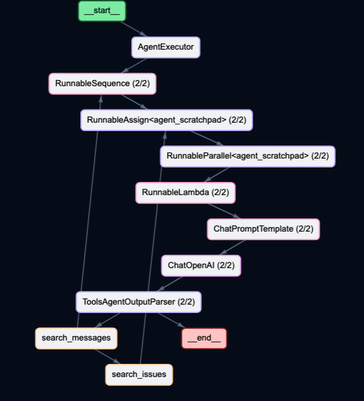
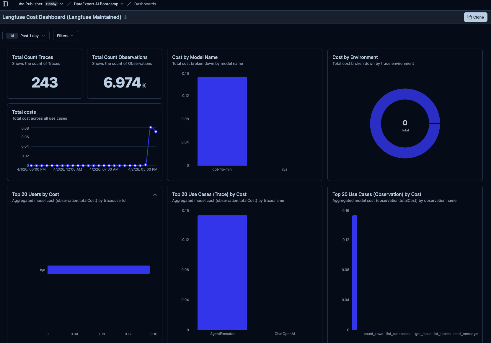
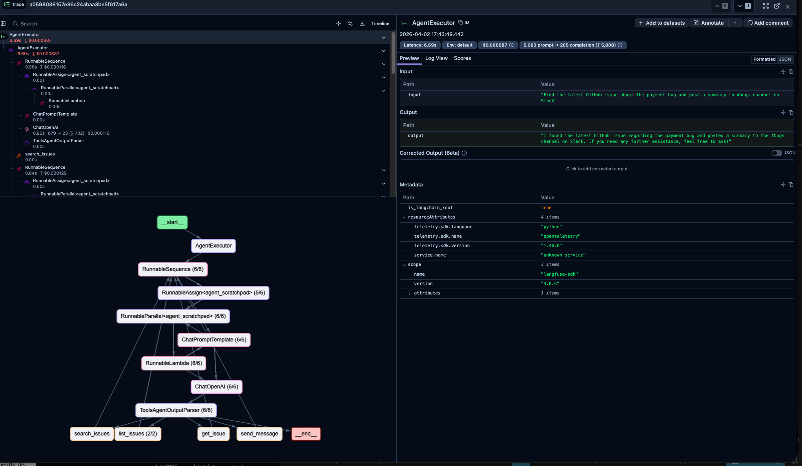
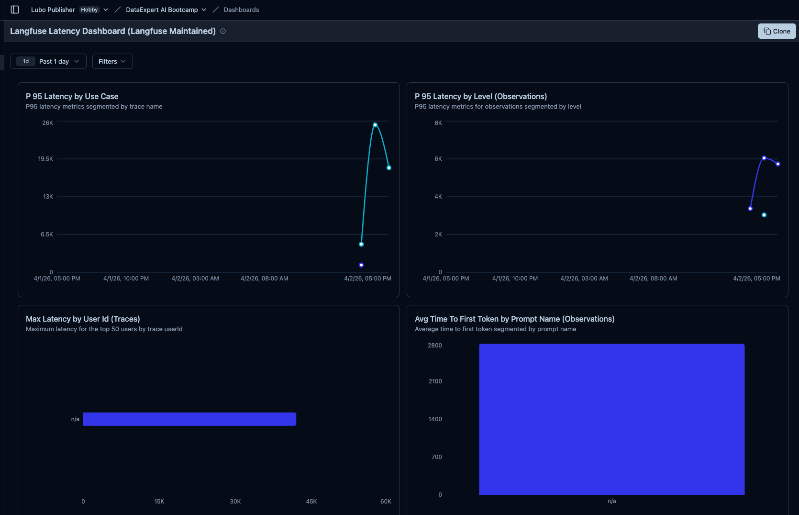

# LangChain AI Agents

[Portfolio](https://lubobali.com) | [LuBot AI](https://lubot.ai) | [LinkedIn](https://www.linkedin.com/in/lubo-bali/recent-activity/all/)

3 AI agents. 46 tests. 0 failures. Built to break, then fixed better than before.

This repo contains 3 real world AI agent problems that happen in production every day, and the fixes that make them production ready. Not toy demos. Not tutorials. Actual patterns you can drop into your codebase today.

## What's Inside

### 1. The Context Overflow Agent
Your support agent dumps the entire database into the LLM context window. Every. Single. Query. 571K tokens gone in one call.

**The fix:** Query parsing + field stripping + output size guards. Result: 571K tokens down to 133. Thats a 99.98% reduction.

### 2. The Infinite Researcher
Your research agent never stops. Every answer leads to more questions. $12 burned and 8 minutes wasted before it crashes.

**The fix:** BudgetManager that tracks real token costs per step, convergent prompt with stopping criteria, hard iteration limits, graceful degradation when budget runs out. Result: $12 down to $0.001.

### 3. The MCP Tool Overload
Your agent has 25 tools from 3 different servers loaded every turn. It picks the wrong tool, burns tokens on descriptions it doesnt need, and takes forever.

**The fix:** Keyword router middleware that classifies the query and loads only the relevant tools. Result: 25 tools down to 6-11 per query. Zero LLM cost for routing.

Here is how the MCP agent routes an ambiguous query across multiple tool servers:



## Quick Start

```bash
pip install -r requirements.txt
cp .env.example .env
# Add your OpenAI API key to .env
```

Run any agent:
```bash
python context_overflow/solution.py
python infinite_researcher/solution.py
python mcp_middleware/solution.py
```

Run all 46 tests:
```bash
pytest -v
```

## The Numbers

| Agent | Before | After | Improvement |
|-------|--------|-------|-------------|
| Context Overflow | 571K tokens/query | 133 tokens/query | 99.98% reduction |
| Infinite Researcher | $12/query, 8 min | $0.001/query, 15s | 12,000x cheaper |
| MCP Tool Overload | 25 tools every turn | 6-11 relevant tools | 56-76% fewer tools |

## Observability

Every agent call is traced with full visibility into token usage, cost, and latency. 243 traces, 6,974 observations, all tracked in real time.



Cross-server queries show the complete execution flow. This trace shows the MCP agent finding a GitHub issue and posting a summary to Slack, with token counts and cost per step:



Latency monitoring across all agent runs:



## Tech Stack

**For the builders:**
Python 3.13 + LangChain 0.3 + OpenAI API + pytest + Langfuse (observability)

**For everyone else:**
AI agents that can use tools, track their own spending, and know when to stop. Built with the same framework powering production AI apps at scale.

## Key Patterns

**RECR Loop** - Write the test first, then build the feature. 46 tests before a single line of solution code.

**Real API calls in tests** - No mocks. Every test hits a real LLM. If it passes here it works in production.

**BudgetManager** - Per-step token and cost tracking with automatic shutoff. Your agent knows how much its spending in real time.

**Keyword Router** - Deterministic query classification at zero LLM cost. Fast, predictable, testable.

**3-Layer Defense** - Query parsing, field stripping, output size guards. Defense in depth for tool outputs.

## What I Added On Top

Beyond the three fixes, I added:

- 46 automated tests across all 3 agents using RECR (test-first) methodology
- BudgetManager class with real time token tracking via LLM callbacks
- Per-step cost logging with cumulative audit trail
- Graceful degradation when budget limits are hit (agent finalizes instead of crashing)
- Langfuse observability wired in for full tracing, latency dashboards, and cost monitoring
- Field stripping for PCI compliance (no card numbers in LLM context)
- Keyword router with zero LLM cost (deterministic classification)
- Cross-server query support (agent chains tools across GitHub + Slack + Database)

## Why This Matters

Every company running AI agents in production will hit these exact problems. Context overflow, runaway costs, tool confusion. These arent edge cases. These are Tuesday.

The patterns in this repo are how you go from "it works in the demo" to "it works at scale."
